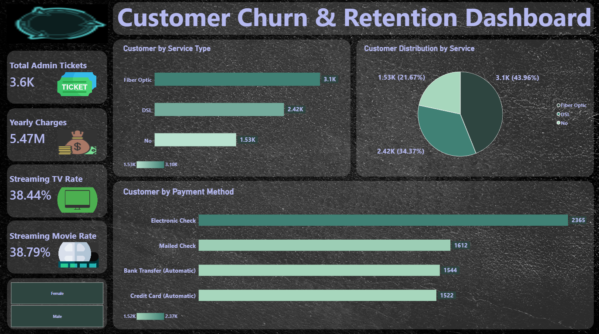

# 📊 Customer Churn & Retention Dashboard | Power BI

An interactive **Customer Churn & Retention Dashboard** built with Microsoft Power BI to explore a telecom customer dataset: customer distribution by service and billing, key business KPIs, and demographic filtering.

---

## 📌 Project Overview

This project analyzes a telecom customer churn dataset (around 7,000 customers) and presents it in a single dark-themed report page.

The dashboard provides an interactive view of:

- 💰 Yearly Charges
- 🎫 Admin Support Tickets
- 📺 Streaming TV Rate
- 🎬 Streaming Movies Rate
- 🌐 Internet Service Types
- 💳 Payment Methods
- 👥 Gender Segments

---

## 🛠️ Tools & Technologies

- **Microsoft Power BI Desktop**
- **DAX** (KPI measures: Yearly Charges, Total Admin Tickets, Streaming TV Rate, Streaming Movies Rate)
- **Data Modeling** (churn dataset with a dedicated measures table)
- **Interactive Slicers**
- **Custom Report Background & Icons**

---

## 📈 Dashboard Highlights

### 💰 KPI Cards
Headline DAX measures for the customer base:

- Total Admin Tickets: **3.6K**
- Yearly Charges: **5.47M**
- Streaming TV Rate: **38.44%**
- Streaming Movies Rate: **38.79%**

### 🌐 Customer by Service Type
Bar chart comparing customer counts across internet service types (Fiber Optic ~3.1K, DSL ~2.4K, No internet service ~1.5K).

### 🥧 Customer Distribution by Service
Pie chart showing the customer share of each internet service type: Fiber Optic **43.96%**, DSL **34.37%**, No internet service **21.67%**.

### 💳 Customer by Payment Method
Bar chart comparing customer counts across payment methods: Electronic Check **2,365**, Mailed Check **1,612**, Bank Transfer (Automatic) **1,544**, Credit Card (Automatic) **1,522**.

### 🎯 Interactive Analysis
A gender slicer (Female / Male) filters the visuals on the page, making it easy to compare the two segments.

---

## 💡 Key Business Questions

The dashboard helps answer questions such as:

1. How are customers distributed across internet service types?
2. Which payment method is most common among customers?
3. What are the total yearly charges across the customer base?
4. How many admin support tickets do customers open?
5. What share of customers stream TV or movies?
6. How do these numbers change when filtering by gender?

---

## 📊 Dashboard Structure

```text
Customer Churn & Retention Dashboard (single page)
│
├── KPI Cards
│   ├── Total Admin Tickets
│   ├── Yearly Charges
│   ├── Streaming TV Rate
│   └── Streaming Movies Rate
├── Customer by Service Type (Bar)
├── Customer Distribution by Service (Pie)
├── Customer by Payment Method (Bar)
└── Gender Slicer (Female / Male)
```

---

## 🖼️ Dashboard Preview



---

## 🎓 Skills Demonstrated

This project demonstrates practical experience in:

- Building interactive Power BI dashboards
- Creating DAX measures for business KPIs
- Organizing a model with a dedicated measures table
- Designing KPI-driven, dark-themed report layouts with a custom background and icons
- Using slicers for interactive segment filtering

---

## 👨‍💻 Author

**Mohamed Salem**

Data Analyst | Power BI | SQL | Excel

This project is part of my practical **Data Analytics** work, focused on data preparation, analysis, visualization, and business intelligence.

---

⭐ **If you find this project useful, feel free to star the repository.**
